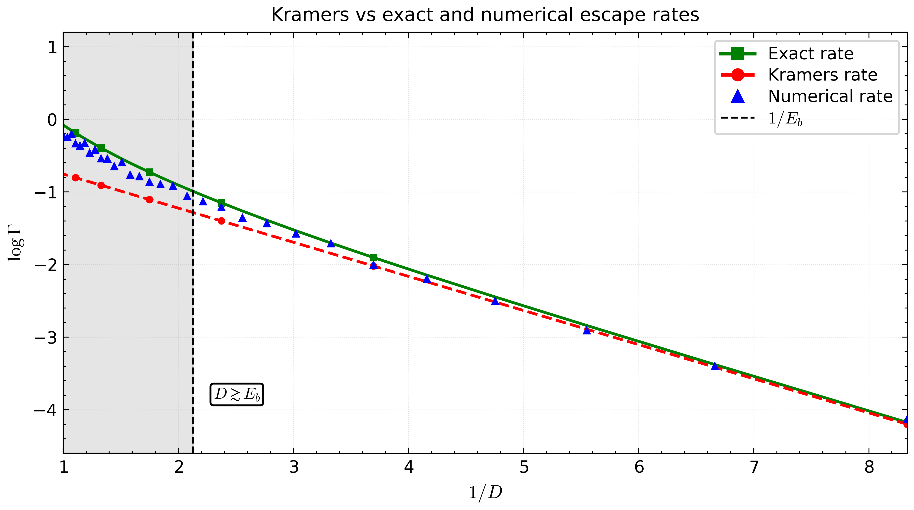

# Stochastic Escape Simulator

Numerical and analytical study of escape rates for overdamped Langevin dynamics in one dimension.



This repository compares three routes to the escape rate from a metastable well in a tilted quartic potential:

- **Numerical simulation** — Euler–Maruyama time stepping with first-passage statistics over many particles (Numba-accelerated)
- **Kramers' rate** — the weak-noise asymptotic, `Γ ≈ ω exp(−E_b / D)`
- **Exact 1D rate** — from the mean first-passage-time double integral

An optional extension replaces white noise with **exponentially correlated coloured noise** via an Ornstein–Uhlenbeck auxiliary process.

## Why

In the weak-noise limit `D → 0` the escape rate is exponentially small, so brute-force simulation becomes expensive exactly where the asymptotics become accurate. Plotting `log Γ` against `1/D` shows the crossover: Kramers' formula is only trustworthy for `D ≪ E_b` (right of the dashed line in the figure), while the exact MFPT rate holds everywhere, and the numerics track it until escapes become too rare to sample.

## Quick start

```bash
pip install -r requirements.txt
python src/stochastic_escape_simulator.py
```

The script runs the Monte Carlo sweep over a range of `D`, computes the Kramers and exact rates, and produces the Arrhenius-style figure above. Parameters live near the top of the file:

- `potential`, `force`, `vpp` — the potential `V(x)` and its derivatives (quartic by default; swap in your own)
- `a`, `b` — location of the metastable minimum and the barrier top
- `x_absorb` — absorbing boundary placed just beyond the barrier
- `N_particles`, `Nsteps`, `dt`, `D_vals` — Monte Carlo settings and the noise-strength sweep
- `noise_mode`, `tau_c` — set `noise_mode = 1` for coloured noise with correlation time `tau_c`

Numerical rates are only reported for `D` values where at least 95% of particles escaped within the simulation window, so points drop out of the plot rather than being biased by truncation.

## Maths notes

See [`docs/maths.md`](docs/maths.md) for the Langevin model, the Kramers derivation and the exact MFPT integral.

## Repository structure

```text
.
├─ docs/maths.md
├─ images/arrhenius_example.png
├─ src/stochastic_escape_simulator.py
├─ requirements.txt
└─ LICENSE
```

## Related work

The path-integral view of the same problem — where the dominant escape paths become complex — is the subject of my PhD thesis, [*Complex saddles in stochastic path integrals*](https://etheses.whiterose.ac.uk/id/eprint/38065/) (Leeds, 2025), and of [Baldwin, McKane & Fitzgerald, *Complex paths for real stochastic processes*](https://arxiv.org/abs/2604.09398) (2026).

## Licence

MIT (see `LICENSE`).
